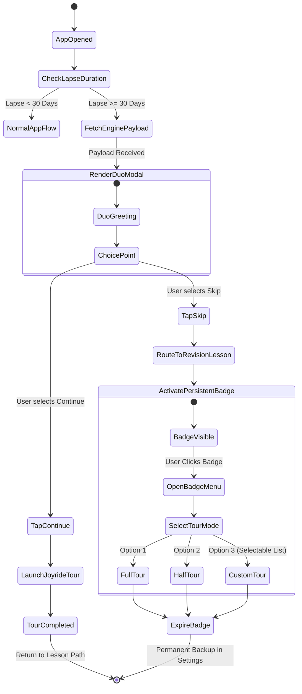

# Duolingo Reactivation Engine — System Architecture & Technical Design

This document details the software architecture, data pipelines, component interactions, and execution flows for the **Duolingo Reactivation Engine**, built strictly according to the specifications defined in [`context.md`](file:///c:/Projects/Duolingo%20project%20teardown/context.md).

---

## 1. Executive Summary & Design Principles

* **North Star Objective:** Maximize lesson completion rates among returning lapsed users ($\text{lapse\_duration} \ge 30\text{ days}$).
* **Deterministic Logic (No-LLM Policy):** The core decision engine runs on pure Python rule trees—guaranteeing sub-100ms latency, zero API costs, 100% deterministic reproducibility, and zero hallucination risk.
* **Component-Decoupled Delivery:** The frontend relies on a lightweight overlay architecture using **React Joyride** for element spotlights and dynamic custom React modals for mascot (Duo) re-engagement.

---

## 2. High-Level Architecture Diagram

```mermaid
graph TD
    subgraph Client Application Layer (React)
        A[App Launch Trigger] -->|Check Lapse >= 30 Days| B[Reactivation Engine Client SDK]
        B -->|Fetch Payload| C[Python Decision Engine REST API]
        C -->|Return Payload JSON| B
        B -->|Render| D{User Interaction}
        D -->|Accept| E[Duo Reintro Modal]
        D -->|Skip| F[Revision Lesson Route + Activate Badge]
        E -->|Handoff| G[React Joyride Spotlight Tour]
        F -->|Click Badge| H[Tour Options Selector: Full / Half / Custom]
    end

    subgraph Decision Engine Layer (Python Services)
        C --> I[Data Aggregator & Fetcher]
        I --> J[Engagement Depth Engine]
        J --> K[Three-Bucket Classifier]
        K --> L[Persona Sequencer & Filter]
        L --> M[Pro-Nudge Guardrail]
        M --> N[Payload Formatter]
    end

    subgraph Data & Storage Layer
        I -->|Query User History & Nudges| O[(PostHog Analytics API)]
        I -->|Query Metadata & Mutations| P[(Supabase PostgreSQL)]
    end
```

---

## 3. Data Flow & Subsystem Architecture

### 3.1 Subsystem Overview

| Component | Technology | Primary Function |
|---|---|---|
| **Client Overlay SDK** | React, React Joyride | Renders Duo modal, spotlight tours, persistent badge, and custom tour menus. |
| **Decision Engine** | Python 3.11 (FastAPI / Pydantic) | Executes classification rules, bucket evaluation, persona sequencing, and guardrails. |
| **Event & Session Storage** | PostHog | Tracks raw user interactions, feature touch frequency/duration, and Pro nudge history. |
| **Product Metadata Store** | Supabase (PostgreSQL) | Maintains canonical feature catalog, launch dates, mutation links, and explanations. |

---

## 4. Detailed Component Specifications

```
                                  ┌──────────────────────────────────┐
                                  │   Incoming User Payload Request  │
                                  └────────────────┬─────────────────┘
                                                   │
                                                   ▼
                                  ┌──────────────────────────────────┐
                                  │  Step 1: Engagement Depth Engine │
                                  │  Duration >= 3s OR Frequency > 2 │
                                  └────────────────┬─────────────────┘
                                                   │
                                                   ▼
                                  ┌──────────────────────────────────┐
                                  │ Step 2: Three-Bucket Classifier  │
                                  │ Reintro / Intro / Mutation       │
                                  └────────────────┬─────────────────┘
                                                   │
                                                   ▼
                                  ┌──────────────────────────────────┐
                                  │  Step 3: Persona Tier Sequencer  │
                                  │ Broad (2-3 extra) vs Narrow      │
                                  └────────────────┬─────────────────┘
                                                   │
                                                   ▼
                                  ┌──────────────────────────────────┐
                                  │  Step 4: Pro Guardrail Filter    │
                                  │  Delay if times_declined >= 1    │
                                  └──────────────────────────────────┘
```

### 4.1 Engagement Depth Engine

Evaluates pre-churn feature touchpoints to filter out accidental clicks or shallow bounces.

* **Bounce Delta:** Inter-event time delta $< 3\text{ seconds}$ is flagged as a bounce.
* **Frequency Override:** Total feature touch count $> 2$ overrides the duration rule.
* **Logic Evaluation:**
$$\text{Engaged}(f) = (\text{avg\_duration}_f \ge 3.0\text{s}) \lor (\text{frequency}_f > 2)$$

### 4.2 Three-Bucket Classification Engine

Compares user activity history against current feature metadata retrieved from Supabase.

1. **Reintroduction Bucket:**
   $$\text{Reintro Candidates} = \{ f \in F_{\text{pre\_churn}} \cap F_{\text{current}} \mid \text{Engaged}(f) = \text{True} \}$$
2. **Introduction Bucket:**
   $$\text{Intro Candidates} = \{ f \in F_{\text{current}} \mid f \notin F_{\text{pre\_churn}} \lor \text{Engaged}(f) = \text{False} \}$$
3. **Mechanic Mutation Bucket (Highest Severity):**
   $$\text{Mutation Candidates} = \{ f_{\text{curr}} \in F_{\text{current}} \mid \exists f_{\text{prev}} \in F_{\text{pre\_churn}} \text{ s.t. } f_{\text{curr}}.\text{replaces\_feature\_id} = f_{\text{prev}}.\text{feature\_id} \}$$

### 4.3 Persona Tier & Composition Engine

Determines the sequence and volume of spotlight items handed off to React Joyride:

* **Automatic Inclusion Rule:** All identified **Mechanic Mutation** items are automatically added to `spotlight_sequence` for both Broad and Narrow tiers (bypassing workflow filters).
* **Broad Persona Tier (Tim-type):**
  $$\text{Spotlight} = \text{Mutations} \cup \text{Workflow\_Matches} \cup \text{Arbitrary\_New\_Features}(N=2\text{–}3)$$
  *Where arbitrary new features satisfy:* $\text{intro\_date} > \text{last\_active\_timestamp} \land \text{user\_facing} = \text{true}$.
* **Narrow Persona Tier (John-type):**
  $$\text{Spotlight} = \text{Mutations} \cup \text{Workflow\_Matches}$$

### 4.4 Pro-Nudge Sequencing Guardrail

Protects reactivated users from premature monetization friction during reorientation.

$$\text{pro\_prompt\_delay} = \begin{cases} \text{True} & \text{if } \text{pro\_nudge\_history.times\_declined} \ge 1 \\ \text{False} & \text{otherwise} \end{cases}$$

---

## 5. Database Schema & Storage Specifications

### 5.1 Supabase Table Schema: `feature_definitions` (Table 5)

```sql
CREATE TABLE feature_definitions (
    feature_id VARCHAR(64) PRIMARY KEY,
    name VARCHAR(128) NOT NULL,
    placement VARCHAR(64) NOT NULL, -- e.g., 'top_bar', 'home_path', 'profile'
    intro_date DATE NOT NULL,
    explanation TEXT NOT NULL,
    replaces_feature_id VARCHAR(64) REFERENCES feature_definitions(feature_id),
    user_facing BOOLEAN NOT NULL DEFAULT TRUE,
    created_at TIMESTAMP WITH TIME ZONE DEFAULT CURRENT_TIMESTAMP
);

CREATE INDEX idx_feature_user_facing ON feature_definitions(user_facing);
CREATE INDEX idx_feature_intro_date ON feature_definitions(intro_date);
```

### 5.2 PostHog Event Model Mapping

* **Tables 1–3 (Usage & Sessions):** Captured via native PostHog event properties (`$session_id`, `feature_id`, `event_duration_seconds`).
* **Table 4 (Pro Nudge History):**
  * `times_declined` (Integer): Total recorded decline events.
  * `avg_decline_speed` (Float): Average seconds elapsed before dismissal.
  * `ever_trialed` (Boolean): Flag indicating past Pro trial usage.

---

## 6. Frontend UI State Machine & User Journey



---

## 7. Python Implementation Contracts

### 7.1 Core Classifier Implementation (Python)

```python
import math
from dataclasses import dataclass
from typing import List, Optional
from datetime import date, datetime

@dataclass
class PreChurnTouchpoint:
    feature_id: str
    frequency: int
    avg_duration: float
    engaged: bool  # Calculated via: (avg_duration >= 3.0) or (frequency > 2)

@dataclass
class PreChurnAchievements:
    lessons_completed: int
    league_wins: int
    words_learned: int
    streak_length: int

@dataclass
class FeatureDefinition:
    feature_id: str
    name: str
    placement: str
    intro_date: date
    explanation: str
    replaces_feature_id: Optional[str]
    user_facing: bool

@dataclass
class ProNudgeHistory:
    times_declined: int
    avg_decline_speed: float
    ever_trialed: bool

class ReactivationEngine:
    BOUNCE_THRESHOLD_SECONDS = 3.0
    FREQUENCY_THRESHOLD = 2

    @classmethod
    def evaluate_engagement(cls, frequency: int, avg_duration: float) -> bool:
        return (avg_duration >= cls.BOUNCE_THRESHOLD_SECONDS) or (frequency > cls.FREQUENCY_THRESHOLD)

    def process_reactivation(
        self,
        last_active: datetime,
        touchpoints: List[PreChurnTouchpoint],
        achievements: PreChurnAchievements,
        features: List[FeatureDefinition],
        pro_history: ProNudgeHistory,
        persona_tier: str = "broad"
    ) -> dict:
        user_facing_features = [f for f in features if f.user_facing]
        touch_map = {t.feature_id: t for t in touchpoints}
        feature_map = {f.feature_id: f for f in user_facing_features}

        # 1. Mechanic Mutation Bucket (Highest Severity - Automatic Inclusion)
        mutations = []
        replaced_feature_ids = set()
        for feat in user_facing_features:
            if feat.replaces_feature_id and feat.replaces_feature_id in touch_map:
                mutations.append({
                    "type": "mechanic_mutation",
                    "feature_id": feat.feature_id,
                    "target_element": f"#{feat.placement}",
                    "message": f"Updated System: {feat.explanation}"
                })
                replaced_feature_ids.add(feat.replaces_feature_id)
                replaced_feature_ids.add(feat.feature_id)

        # 2. Workflow Matches Computation (Applied for BOTH Broad & Narrow Tiers)
        # Includes pre-churn engaged features still active and not replaced by a mutation
        workflow_matches = []
        for touch in touchpoints:
            if touch.engaged and touch.feature_id in feature_map and touch.feature_id not in replaced_feature_ids:
                feat = feature_map[touch.feature_id]
                workflow_matches.append({
                    "type": "workflow_match",
                    "feature_id": feat.feature_id,
                    "target_element": f"#{feat.placement}",
                    "message": f"Welcome back to {feat.name}: {feat.explanation}"
                })

        # Base sequence for both tiers = Mutations + Workflow Matches
        spotlight_sequence = list(mutations) + workflow_matches

        # 3. Broad Tier Arbitrary New Feature Expansion
        if persona_tier == "broad":
            existing_ids = {s["feature_id"] for s in spotlight_sequence}
            new_unseen_features = [
                f for f in user_facing_features 
                if f.intro_date > last_active.date() 
                and f.feature_id not in existing_ids 
                and not f.replaces_feature_id
            ][:3]
            for feat in new_unseen_features:
                spotlight_sequence.append({
                    "type": "introduction",
                    "feature_id": feat.feature_id,
                    "target_element": f"#{feat.placement}",
                    "message": feat.explanation
                })

        # 4. Pro Guardrail Filter
        pro_prompt_delay = pro_history.times_declined >= 1

        # 5. Build Reintroduction Payload
        tone = "celebratory" if persona_tier == "broad" else "action_oriented"
        reintroduction_payload = {
            "stats": {
                "lessons_completed": achievements.lessons_completed,
                "league_wins": achievements.league_wins,
                "words_learned": achievements.words_learned,
                "streak_length": achievements.streak_length
            },
            "tone": tone
        }

        # 6. Build Badge Options
        # Scoped to relevant candidate pool (Workflow Matches, Mutations, and New Features introduced since last active)
        workflow_match_ids = {item["feature_id"] for item in workflow_matches}
        mutation_ids = {item["feature_id"] for item in mutations}
        selectable_features = [
            f for f in user_facing_features
            if f.feature_id in workflow_match_ids
            or f.feature_id in mutation_ids
            or f.intro_date > last_active.date()
        ]

        half_count = math.ceil(len(spotlight_sequence) / 2)
        badge_options = {
            "complete_tour": {
                "spotlight_sequence": spotlight_sequence
            },
            "half_tour": {
                "spotlight_sequence": spotlight_sequence[:half_count]
            },
            "custom_tour": {
                "selectable_items": [
                    {
                        "feature_id": f.feature_id,
                        "one_liner": f.explanation
                    }
                    for f in selectable_features
                ]
            }
        }

        # Return full output schema contract matching Spec Section 8.4
        return {
            "reintroduction_payload": reintroduction_payload,
            "spotlight_sequence": spotlight_sequence,
            "pro_prompt_delay": pro_prompt_delay,
            "badge_state": "not_yet_shown",
            "badge_options": badge_options
        }
```

---

## 8. Open Issues & Architecture Technical Debt

1. **Workflow Matching Quantification (Section 9.3):**
   * The rule governing *"matching the user's pre-churn workflow"* is currently a conceptual policy. In the initial phase, all engaged pre-churn features are treated as candidate matches until a formal similarity coefficient is established.
2. **Prioritization Matrix:**
   * Effort vs. Impact ranking across features is explicitly deferred to post-prototype validation.
