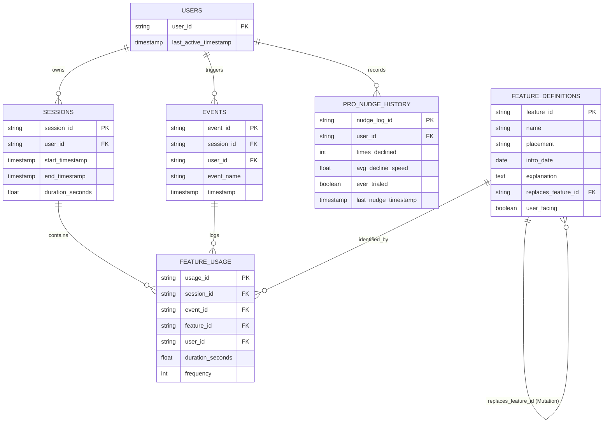

# Duolingo Reactivation Engine — Official Data Schema Documentation (`data-schema.md`)

This document serves as the official, canonical technical reference for all data models, entity relationships, database schemas, and API payload contracts powering the **Duolingo Reactivation Engine**.

---

## 1. Storage Architecture Overview

The system uses a hybrid data architecture split between event analytics and relational metadata stores:

```
                               ┌──────────────────────────────────────────────┐
                               │           PostHog Analytics Platform         │
                               │  - Table 1: events                           │
                               │  - Table 2: sessions                         │
                               │  - Table 3: feature_usage                    │
                               │  - Table 4: pro_nudge_history                 │
                               └──────────────────────┬───────────────────────┘
                                                      │
                                                      │ Joins via feature_id
                                                      ▼
                               ┌──────────────────────────────────────────────┐
                               │            Supabase PostgreSQL DB            │
                               │  - Table 5: feature_definitions              │
                               │    (Contains self-referential mutation FKs)  │
                               └──────────────────────────────────────────────┘
```

* **PostHog (Tables 1–4):** Captures high-volume user activity streams, pre-churn feature touchpoints, session duration metrics, user achievements, and monetization nudge interaction logs.
* **Supabase / PostgreSQL (Table 5):** Stores product metadata, launch dates, DOM placement selectors, mechanic mutation replacement links, and `user_facing` visibility flags.

---

## 2. Entity-Relationship (ER) Diagram



---

## 3. Table Specifications & Schema Definitions

### 3.1 Table 1: `events` (PostHog Event Log)
Captures raw analytics events emitted by returning and pre-churn users.

| Column Name | Data Type | Constraints | Description |
|---|---|---|---|
| `event_id` | `VARCHAR(64)` | `PRIMARY KEY` | Unique event identifier |
| `session_id` | `VARCHAR(64)` | `FOREIGN KEY` | References `sessions.session_id` |
| `user_id` | `VARCHAR(64)` | `INDEXED` | Unique user ID |
| `event_name` | `VARCHAR(128)` | `NOT NULL` | Event type (e.g., `'lesson_started'`, `'feature_touched'`) |
| `timestamp` | `TIMESTAMPTZ` | `NOT NULL` | Precise UTC event timestamp |

---

### 3.2 Table 2: `sessions` (PostHog Session Log)
Tracks user session durations and pre-churn activity windows.

| Column Name | Data Type | Constraints | Description |
|---|---|---|---|
| `session_id` | `VARCHAR(64)` | `PRIMARY KEY` | Unique session identifier |
| `user_id` | `VARCHAR(64)` | `FOREIGN KEY` | Unique user ID |
| `start_timestamp` | `TIMESTAMPTZ` | `NOT NULL` | Session start time |
| `end_timestamp` | `TIMESTAMPTZ` | `NOT NULL` | Session end time |
| `duration_seconds` | `FLOAT` | `NOT NULL` | Total active session length |

---

### 3.3 Table 3: `feature_usage` (PostHog Pre-Churn Touchpoints)
Stores granular feature interaction history used by the Engagement Depth Engine.

| Column Name | Data Type | Constraints | Description |
|---|---|---|---|
| `usage_id` | `VARCHAR(64)` | `PRIMARY KEY` | Unique record ID |
| `session_id` | `VARCHAR(64)` | `FOREIGN KEY` | References `sessions.session_id` |
| `event_id` | `VARCHAR(64)` | `FOREIGN KEY` | References `events.event_id` |
| `feature_id` | `VARCHAR(64)` | `FOREIGN KEY` | References `feature_definitions.feature_id` |
| `user_id` | `VARCHAR(64)` | `INDEXED` | Unique user ID |
| `duration_seconds` | `FLOAT` | `NOT NULL` | Time spent on feature before next event |
| `frequency` | `INTEGER` | `NOT NULL` | Total touch count in pre-churn window |
| `timestamp` | `TIMESTAMPTZ` | `NOT NULL` | Interaction timestamp |

* **Engagement Rule Formula:**
$$\text{Engaged} = (\text{duration\_seconds} \ge 3.0\text{s}) \lor (\text{frequency} > 2)$$

---

### 3.4 Table 4: `pro_nudge_history` (PostHog Monetization Tracking)
Tracks user interactions with Pro trial and monetization prompts. Powers the Pro-nudge delay guardrail.

| Column Name | Data Type | Constraints | Description |
|---|---|---|---|
| `nudge_log_id` | `VARCHAR(64)` | `PRIMARY KEY` | Unique nudge log record |
| `user_id` | `VARCHAR(64)` | `INDEXED` | Unique user ID |
| `times_declined` | `INTEGER` | `NOT NULL, DEFAULT 0` | Total recorded decline/dismiss events |
| `avg_decline_speed` | `FLOAT` | `NOT NULL, DEFAULT 0.0` | Average seconds elapsed before dismissal |
| `ever_trialed` | `BOOLEAN` | `NOT NULL, DEFAULT FALSE` | Flag indicating past Pro trial usage |
| `last_nudge_timestamp`| `TIMESTAMPTZ` | `NULLABLE` | Timestamp of most recent nudge |

* **Pro Guardrail Rule Formula:**
$$\text{pro\_prompt\_delay} = (\text{times\_declined} \ge 1)$$

* **Telemetry Aggregation Mapping:** Individual dismissals emit the raw event property `decline_speed_seconds` upon each `pro_nudge_declined` event. PostHog aggregations compute the mean of these per-event timestamps to populate Table 4's `avg_decline_speed`.

---

### 3.5 Table 5: `feature_definitions` (Supabase PostgreSQL Relational Metadata)
Canonical relational catalog storing product features, DOM placement target selectors, launch dates, and mutation replacement links.

```sql
CREATE TABLE feature_definitions (
    feature_id VARCHAR(64) PRIMARY KEY,
    name VARCHAR(128) NOT NULL,
    placement VARCHAR(64) NOT NULL,
    intro_date DATE NOT NULL,
    explanation TEXT NOT NULL,
    replaces_feature_id VARCHAR(64) REFERENCES feature_definitions(feature_id),
    user_facing BOOLEAN NOT NULL DEFAULT TRUE,
    created_at TIMESTAMP WITH TIME ZONE DEFAULT CURRENT_TIMESTAMP
);

CREATE INDEX idx_feature_user_facing ON feature_definitions(user_facing);
CREATE INDEX idx_feature_intro_date ON feature_definitions(intro_date);
CREATE INDEX idx_feature_replaces ON feature_definitions(replaces_feature_id);
```

| Column Name | Data Type | Constraints | Description |
|---|---|---|---|
| `feature_id` | `VARCHAR(64)` | `PRIMARY KEY` | Canonical feature slug (e.g. `'energy_system'`, `'feed'`) |
| `name` | `VARCHAR(128)` | `NOT NULL` | Human-readable feature name |
| `placement` | `VARCHAR(64)` | `NOT NULL` | Target DOM element ID selector (e.g. `'energy-indicator'`) |
| `intro_date` | `DATE` | `NOT NULL` | Global feature release date |
| `explanation` | `TEXT` | `NOT NULL` | Tooltip/spotlight one-liner explanation |
| `replaces_feature_id`| `VARCHAR(64)` | `FOREIGN KEY (Self)`| Links new feature to pre-churn mechanic it mutates |
| `user_facing` | `BOOLEAN` | `NOT NULL, DEFAULT TRUE` | `TRUE` = Visible UI feature; `FALSE` = Backend/infra update |

---

## 4. API Request & Response Data Contracts

### 4.1 Decision Engine Input Payload Contract (JSON)
Received by `POST /api/v1/reactivation/evaluate` on app launch when $\text{lapse\_duration} \ge 30\text{ days}$.

```json
{
  "user_id": "usr_98412039",
  "last_active_timestamp": "2025-11-15T10:30:00Z",
  "current_timestamp": "2026-01-10T08:15:00Z",
  "lapse_duration_days": 56,
  "persona_tier": "broad",
  "pre_churn_feature_touchpoints": [
    {
      "feature_id": "hearts_system",
      "frequency": 14,
      "avg_duration": 4.5,
      "engaged": true
    },
    {
      "feature_id": "practice_option",
      "frequency": 5,
      "avg_duration": 12.0,
      "engaged": true
    }
  ],
  "pre_churn_achievements": {
    "streak_length": 18,
    "league_placements": "Gold",
    "league_wins": 2,
    "words_learned": 420,
    "lessons_completed": 110,
    "gems": 650,
    "level": 5
  },
  "pro_nudge_history": {
    "times_declined": 1,
    "avg_decline_speed": 1.4,
    "ever_trialed": false
  },
  "feature_definitions_current": [
    {
      "feature_id": "energy_system",
      "name": "Energy System",
      "placement": "energy-indicator",
      "intro_date": "2025-12-01",
      "feature_explanation": "Hearts are now Energy! Here is how your daily lives work now.",
      "replaces_feature_id": "hearts_system",
      "user_facing": true
    },
    {
      "feature_id": "practice_option",
      "name": "Practice Hub",
      "placement": "nav-practice",
      "intro_date": "2024-05-10",
      "feature_explanation": "Review previous mistakes and strengthen weak words.",
      "replaces_feature_id": null,
      "user_facing": true
    },
    {
      "feature_id": "feed_tab",
      "name": "Social Feed",
      "placement": "nav-feed",
      "intro_date": "2025-12-20",
      "feature_explanation": "See quest updates and celebrate friend streaks.",
      "replaces_feature_id": null,
      "user_facing": true
    }
  ]
}
```

---

### 4.2 Decision Engine Output Payload Contract (JSON)
Delivered by `POST /api/v1/reactivation/evaluate` to the React client SDK (Spec Section 8.4).

```json
{
  "reintroduction_payload": {
    "stats": {
      "lessons_completed": 110,
      "league_wins": 2,
      "words_learned": 420,
      "streak_length": 18
    },
    "tone": "celebratory"
  },
  "spotlight_sequence": [
    {
      "type": "mechanic_mutation",
      "feature_id": "energy_system",
      "target_element": "#energy-indicator",
      "message": "Updated System: Hearts are now Energy! Here is how your daily lives work now."
    },
    {
      "type": "workflow_match",
      "feature_id": "practice_option",
      "target_element": "#nav-practice",
      "message": "Welcome back to Practice Hub: Review previous mistakes and strengthen weak words."
    },
    {
      "type": "introduction",
      "feature_id": "feed_tab",
      "target_element": "#nav-feed",
      "message": "See quest updates and celebrate friend streaks."
    }
  ],
  "pro_prompt_delay": true,
  "badge_state": "not_yet_shown",
  "badge_options": {
    "complete_tour": {
      "spotlight_sequence": [
        {
          "type": "mechanic_mutation",
          "feature_id": "energy_system",
          "target_element": "#energy-indicator",
          "message": "Updated System: Hearts are now Energy! Here is how your daily lives work now."
        },
        {
          "type": "workflow_match",
          "feature_id": "practice_option",
          "target_element": "#nav-practice",
          "message": "Welcome back to Practice Hub: Review previous mistakes and strengthen weak words."
        },
        {
          "type": "introduction",
          "feature_id": "feed_tab",
          "target_element": "#nav-feed",
          "message": "See quest updates and celebrate friend streaks."
        }
      ]
    },
    "half_tour": {
      "spotlight_sequence": [
        {
          "type": "mechanic_mutation",
          "feature_id": "energy_system",
          "target_element": "#energy-indicator",
          "message": "Updated System: Hearts are now Energy! Here is how your daily lives work now."
        },
        {
          "type": "workflow_match",
          "feature_id": "practice_option",
          "target_element": "#nav-practice",
          "message": "Welcome back to Practice Hub: Review previous mistakes and strengthen weak words."
        }
      ]
    },
    "custom_tour": {
      "selectable_items": [
        {
          "feature_id": "energy_system",
          "one_liner": "Hearts are now Energy! Here is how your daily lives work now."
        },
        {
          "feature_id": "practice_option",
          "one_liner": "Review previous mistakes and strengthen weak words."
        },
        {
          "feature_id": "feed_tab",
          "one_liner": "See quest updates and celebrate friend streaks."
        }
      ]
    }
  }
}
```
